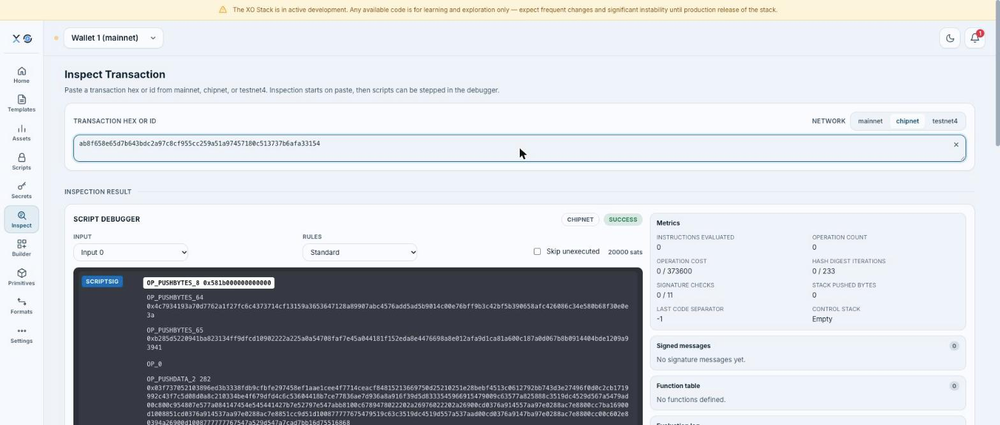

# Chipnet proof: AgentTab through XO invitations

Every transaction below was built, signed and broadcast by `@xo-cash/engine` `0.1.1-next.18230317763` from an XO invitation. Each invitation is saved in [`../invitations/`](../invitations) as XO extended JSON (`serializeInvitation`).

- Template: [`../dist/agenttab.template.json`](../dist/agenttab.template.json). Its template identifier (as `importTemplate` stores it) is `987d55cca82ab989560111d399b37c23ef72df0b0fca08a3c16b602cc1865a60`.
- Network: chipnet. Explorer: `https://explorer.selene.cash/tx/<txid>?network=chipnet`.
- Parties: owner and provider are two separate XO accounts (two mnemonics), and each runs in its own process. The agent is not an XO party: it signs vouchers off-chain with its own key.
- All keys are fresh chipnet test keys, kept in a gitignored `.env`.

`node scripts/inspect.ts <files>` checks each invitation offline:
1. It validates the file against XO's schema (`deserializeInvitation`).
2. It rebuilds the transaction from the merged commits with the template (`mergeInvitationCommits` + `buildInvitationTransactionFromMergedCommit`).
3. It checks that the rebuilt hash equals the `result` recorded in the invitation.

All final-template invitations below (t2, t3, t5, t6, t7) match. Confirmations were checked with `node scripts/tx-status.ts <txid>` against `chipnet.imaginary.cash`.

## Final template (`987d55cc…`)

| Tab | Action | XO invitation id | Invitation file | Chipnet txid | What the chain shows |
|---|---|---|---|---|---|
| t2 | openTab (owner and provider) | `91f7c959d43a84e33a816ef8fa6d0520` | `t2.open.json` | `0eeb5b63eb48dbe382914a0d7d20c360209fead288a0111610edb679b1225d6a` | 20,000 sats to the P2SH32 covenant, change to the owner |
| t2 | **settle** (provider, agent voucher for 7,000) | `6f944ff38b2cb45abb96204a674c4cc6` | `t2.settle.json` | `ab8f658e65d7b643bdc2a97c8cf955cc259a51a97457180c513737b6afa33154` | output 0: provider 6,000 (7,000 minus the 1,000 fee). Output 1: owner exactly 13,000 |
| t3 | openTab | `b7ac035ebde54691ac4da83a4e729c23` | `t3.open.json` | `e0dbfe66ad133dce268e956217e28c6b58ea12b5a3c5279c3d3d8dcc7686911b` | 10,000 sats locked |
| t3 | **cancel** (provider) | `6045b5ed3b74eeb05d256bc53a4045d9` | `t3.cancel.json` | `582c0710128069dbb4851a7f9422cb671c59ae650f094f27327458b37b964c65` | owner 9,000 (the covenant caps the fee at 1,000) |
| t5 | openTab, timeout = lock height 333306 | `172ac7c143fbb4376c2e7c281ea3599c` | `t5.open.json` | `b5f8399566b1c58fc14cc3022763dfec4b0534b37ecbf2c75906ffa16ef46d40` | 10,000 sats locked |
| t5 | **refund** (owner, after the timeout) | `8990730bd181c32354799df0316f52c3` | `t5.refund.json` | `d04830c789ed921c851715ea8388534a80c4c1302cec4c03fbf63ee6df1169be` | nLockTime 333306, input sequence 0xfffffffe, owner 9,000 |
| t6 | openTab and settle (voucher 3,000) | `85b4213657c9cf189c5918848a663fe7`, `310138f3aef97d376abc19210ec10cb3` | `t6.open.json`, `t6.settle.json` | `ea5e55577ff3622292bf825a01657d5c6e3344ed24068ae3251c3abc84001732`, `d7c02ece8a53d764689d2a320a04dcb83a992cb888b551ebb0e77ea11bb85e2f` | provider 2,000, owner 7,000 |
| t7 | openTab | `9dbd3744b5304c56b002114103f89de6` | `t7.open.json` | `7d1c344776224183a9953c0b9863315d79cb4124da81e3d04abc0eb9b36067a6` | 10,000 sats locked |
| t7 | settle with a **forged amount** (claims 5,000 on a voucher for 3,000) | archived | none | `ae14a90a…` was never mined | XO built and signed it. The node rejected it: `mandatory-script-verify-flag-failed (Signature must be zero for failed CHECK(MULTI)SIG operation)`, meaning the voucher datasig fails |
| t7 | honest settle (voucher 3,000) | `17c4edbf0fcaf50d075c6026f74a574a` | `t7.settle.json` | `07ca7ac35d3192d0364c0d73619ca16a7d7bf940df14a416c786698aecda360c` | provider 2,000, owner 7,000 |

The open invitations have 8 commits from 2 entities (owner and provider):
- the owner's variables;
- the provider joining, and its `providerKey.public_key` resolution;
- the owner's resolution, output, input, change and signature.

Each settle, cancel and refund invitation has 4 commits from 1 entity.

## Earlier runs

- **t1 (first template version, `cb389344…`).** This was the first open and settle through XO:
  - open invitation `5058e57a590701483f8449b52fc5897f`, tx `93db6ad55782c3553e93060dc710d6eee8edacb0182181635c525fc645057838`;
  - settle tx `0c588f7e3cb16309227788290b45155cda022c1325955929d3181e40582d7906`: provider 5,000, owner exactly 14,000.

  The template changed after this run (`budgetSatoshis` was added to the follow-up requirements), so the t1 files carry the older template id.
- **t4.** Opened (`200272a6394fc91e90d07476884daa18b046970ce7b2f77c57180ab05eca6ca7`) with a timeout in **raw** block height. Its refund was rejected with `bad-txns-nonfinal`, because chipnet nLockTime counts in faster-blocks lock height (see `docs/xo-findings.md`). The provider then cancelled it (`c24fb00fc29a48782c084c7544da9e7488d46de0c79b301da0af52a98ca2cd98`), so nothing is stuck.

## Inspecting in the XO debug tool (https://blaze.xo.cash)

**Not done by the builder.** The tool opens with "Create new account / Use existing mnemonic", and we did not create a wallet there. The likely path, from the tool's UI bundle (Import Template / Import JSON / Import Invitation modals):
1. Create a throwaway account.
2. Use **Import Template** with `dist/agenttab.template.json`.
3. Import an invitation file, e.g. `invitations/t2.settle.json`, then `t2.open.json`.

The offline `scripts/inspect.ts` check above runs the same parse-and-merge path the engine uses.

## Checked in the XO debugger (blaze.xo.cash)
The template imports into blaze.xo.cash ("Template imported: AgentTab"), and the chipnet settle `ab8f658e…3154` inspects as SUCCESS in the XO script debugger:

